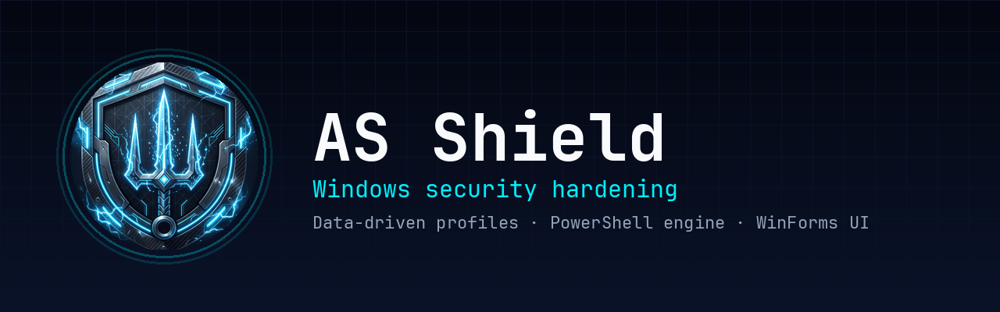
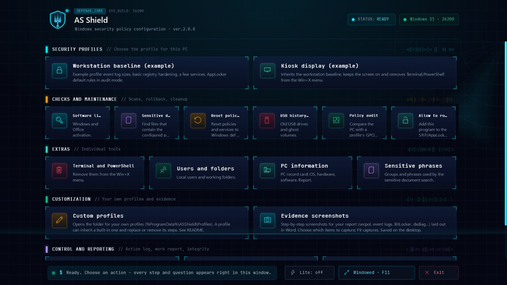

<div align="center">



# AS Shield

**A data-driven Windows hardening tool.** Security profiles are JSON, not code — a `profile.json` lists ordered steps, and a PowerShell engine applies each one through a typed handler, behind a WinForms front end.

[](LICENSE)


</div>

> **Status:** 2.0 — a public rewrite of an internal 1.x tool. Test every profile in a VM or on a spare machine before using it on real workstations.

---

## Screenshot



---

## What it does

- **Data-driven profiles.** `Payload/Profiles/<id>/profile.json`, with inheritance (`basedOn`, `removeSteps`), per-OS values (`{"10": ..., "11": ...}`), conditions (`when`), confirmations (`confirm`) and an `onError` policy.
- **Plan mode.** Shows what a profile *would* do without changing anything.
- **Clear results.** Each step returns `OK`, `DONE`, `SKIP` or `FAIL`; the process exit code is `0` (no failures), `2` (some steps failed), `1` (stopped by `onError: stop`) or `3` (not run).
- **Local profiles.** Administrators drop their own profiles into `%ProgramData%\ASShield\Profiles`, loaded only when that folder is writable by Administrators/SYSTEM alone.
- **Payload integrity.** The embedded payload is checked against a SHA-256 manifest before every run, and the extraction folder gets a High integrity label.
- **Built-in tools.** Reset policies to Windows defaults, USB history cleanup, software-license report, sensitive-phrase document scan, PC information card, policy compliance audit, system integrity check, and evidence screenshots with `.docx` reports.

### Step types

| Type | Does |
|---|---|
| `restorePoint` | Create a system restore point |
| `registry` | Set registry values (per-OS aware) |
| `services` | Set service start types |
| `appLocker` | Apply an AppLocker policy |
| `lgpo` / `lgpoText` | Import a GPO backup / apply LGPO-text settings |
| `eventLogs` | Size and retention of event logs |
| `folder` / `userProfilesPath` | Create folders / move the new-user profile path |
| `removeApps` / `removeWinXShell` | Remove provisioned apps / Win+X shell entries |
| `shotPolicies` | Apply the policies behind the evidence screenshots |
| `userRoles` / `selfExclusion` / `script` | Create users & roles / self-exclusion rule / custom script |

## Repository layout

```
App/            C# WinForms front end (.NET Framework 4.7.2)
Payload/        Everything packed into the exe as payload.zip
  RunAction.ps1   Entry point invoked by the GUI
  Engine/         Profile engine: Lib (loader, resolver) + Steps (handlers)
  Profiles/       Built-in example profiles
  Configs/        Shared configuration (defaults, examples)
  Catalog/        menu.json (GUI menu) and shots.json (evidence screenshots)
  Schema/         JSON Schema for profile.json
build/          Build, validation, hashing and signing scripts
tests/          Engine mock test (runs on Linux/macOS with PowerShell 7)
```

## Building

Requirements: Windows, PowerShell 5.1 or 7, and the .NET SDK (to build a `net472` project).

```powershell
.\build\build.ps1                          # get-lgpo -> validate -> pack -> hash -> dotnet build
.\build\build.ps1 -CertThumbprint <thumb>  # also Authenticode-sign the scripts and the exe
```

`build\get-lgpo.ps1` downloads **LGPO.exe** from the Microsoft Download Center (Security Compliance Toolkit) and checks its SHA-256. LGPO is Microsoft software and is **not** included in this repository.

## Writing a profile

```json
{
  "schemaVersion": 2,
  "id": "my-profile",
  "title": "My profile",
  "os": { "supported": ["10", "11"] },
  "basedOn": "workstation-baseline",
  "steps": [
    { "id": "no-autorun", "type": "registry",
      "params": { "values": [
        { "path": "HKLM:\\SOFTWARE\\Microsoft\\Windows\\CurrentVersion\\Policies\\Explorer",
          "name": "NoDriveTypeAutoRun", "type": "DWord", "value": 255 } ] } }
  ]
}
```

Put it in `Payload/Profiles/my-profile/` (built in) or `%ProgramData%\ASShield\Profiles\my-profile\` (local), then run `build\validate.ps1`. The full format is in `Payload/Schema/profile.schema.json`. The shipped examples are `workstation-baseline` and `kiosk-display` (which inherits from it).

**GPO backups.** The `lgpo` step imports a GPO backup folder. None are shipped, because a real backup reflects one organization's policy. Export your own with `LGPO.exe /b`, put it under `Payload/Configs/`, point the step's `gpo` parameter at it and set `"enabled": true`.

## Testing

```powershell
pwsh ./tests/run-mock.ps1   # runs the engine with mocked Windows APIs
pwsh ./build/validate.ps1   # validates every profile and the catalog files
```

## Security notes

- The app requires elevation and uses a normal UAC prompt. It does **not** bypass UAC.
- Scripts run with `-ExecutionPolicy Bypass` from the extracted payload; the integrity check and folder ACLs exist for this reason. For production, sign the build and use `AllSigned`.
- See [SECURITY.md](SECURITY.md) to report a vulnerability.

## License

MIT — see [LICENSE](LICENSE). Third-party components are listed in [NOTICE](NOTICE).
